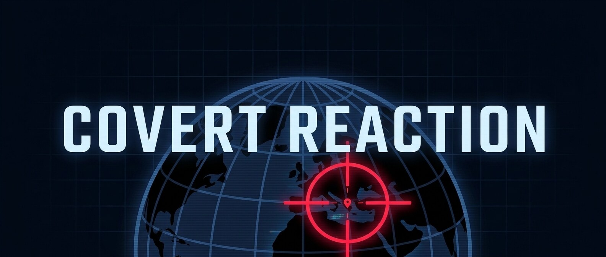

# Covert Reaction

A modern, portable remake of Sid Meier's Covert Action (MicroProse, 1990), for
macOS, Windows, Linux and the web. It plays with the files of your own copy of
the original game, so you need a copy: GOG sells one, and the original floppy
disks work too.

The game logic is ported from the byte-exact reconstruction of the original
source in [covert-recomp](https://github.com/bertrandom/covert-recomp), so the
rules are the original's, not guesswork: cases, the world simulation, the four
mini-games and the music give the same results as the 1990 game.

**[Download](https://github.com/bertrandom/covert-reaction/releases/latest)** ·
**[Play it](#playing-covert-reaction)** · **[Develop it](#developing)**

## Status

The whole game is playable, from the title to retirement:

- **Front end:** title and credits, new character, plot and case briefings, the
  leader line-up, the Hall of Fame, practice missions, saving and loading.
- **The city loop:** travel, the hotel, the CIA (intelligence scans, the research
  office, coded messages, accusing double agents), buildings (wiretap, break in,
  watch, follow), data files, dossiers, clue cards, the teletype, time and events.
- **Mini-games**, both in practice and in a case, where what you find changes the
  case: break-ins (TAC), car chases (CHASE), wiretaps and car tracers (BUG) and
  code breaking (CODE).
- **End of case:** debriefing, timeline, scoring, promotion, the next case and
  retirement.
- **Sound:** the original's MT-32, AdLib and PC speaker music and effects.

Not done yet:

- Joystick or gamepad support (the original has a joystick option).
- Modern extras: remappable keys, save anywhere, a faster pace, higher-resolution
  text.
- A few paths are ported but have not been played through yet: being captured,
  prisoner exchanges and jailbreaks.

[ROADMAP.md](ROADMAP.md) has the details.

---

## Playing Covert Reaction

### Installing

Download the latest version for your system from the
**[Releases page](https://github.com/bertrandom/covert-reaction/releases/latest)**.

**macOS** (11 or later, Apple Silicon or Intel): open `Covert-Reaction-macOS.dmg`
and drag **Covert Reaction** to **Applications**.

The first time you open it, macOS warns that it couldn't verify the app and
won't open it: the app is ad-hoc signed, not signed with a Developer ID and
notarized by Apple, and a download (from a browser, AirDrop or Messages) is
marked as "quarantined". Either:

- open it once, close the warning, and click **Open Anyway** in System
  Settings › Privacy & Security (near the bottom), then confirm; on macOS 14 and
  earlier, Control-click the app and choose **Open** instead; or
- remove the quarantine flag in Terminal, after which it opens without a warning:

  ```bash
  xattr -dr com.apple.quarantine "/Applications/Covert Reaction.app"
  ```

Either way, it opens normally from then on.

**Windows** (64-bit): unzip `Covert-Reaction-Windows.zip` and run
`Covert Reaction.exe`, keeping `SDL2.dll` next to it. The app isn't signed, so
Windows SmartScreen may ask before the first run: click **More info**, then
**Run anyway**.

**Linux** (x86-64 or ARM64): unpack `Covert-Reaction-Linux-x86_64.tar.gz` (or
`-arm64`) and run `covert-reaction`. It needs SDL2: `sudo apt install
libsdl2-2.0-0` on Debian and Ubuntu, `sudo dnf install SDL2` on Fedora.

Or build it yourself (see [Building](#building)).

**In a browser:** the [web build](#web) runs the game in a page; it asks for
your copy of the game there.

### Your copy of the game

The first time Covert Reaction starts, it shows a setup screen with two cards:

- **Game files** (required): click **Choose…** and pick your copy of Covert
  Action, as you have it. Any of these work:
  - GOG's installer for Windows (`.exe`), macOS (`.pkg`) or Linux (`.sh`)
  - the app GOG's macOS installer installs (`Sid Meier's Covert Action.app`,
    usually in Applications)
  - eXoDOS's archive (`Covert Action (1990).zip`), or any zip with the game
  - the original floppy disks: a `.7z` of disk images, a folder of disk images,
    or a single image
  - a folder that already holds the game (an installed copy, from DOSBox or GOG)

  Nothing is installed: the game's files are copied out of it into Covert
  Reaction's own folder, and each file is checked against the known releases. A
  file that doesn't match, such as one from a badly read disk image, is named in
  a warning.
- **MT-32 ROMs** (optional): for the music as it was written, on an emulated
  Roland MT-32 (see [Sound](#sound)). **Choose…** takes a `.zip` or `.7z` of
  ROMs, a folder, or a ROM file. Without them, the music plays on the AdLib.

Then press **START**. The same screen is in the Options (**Game files and
ROMs...**) to change either later.

### Keys

The keys are the original's (see the original manual and reference card). A few
notes:

- **Text windows and menus:** Up/Down move, Enter, Space or F1 choose, Esc
  cancels (keys only: the original has no mouse support). As in the original,
  inside any text window Alt-A switches animations, Alt-S sound and Alt-J the
  joystick bit (each with a short sound), and Alt-Q asks whether to quit.
- **No numeric keypad?** In TAC and BUG, 7 8 9 / U I O / J K L work as the
  keypad (7 8 9 / 4 5 6 / 1 2 3), and BUG also takes the number row. In TAC
  these walk and Shift+key dives (the arrows and Home/End/PgUp/PgDn dive, as in
  the original); I (keypad 5) toggles sneaking.
- **Function keys on a Mac:** TAC's actions are on F1-F10, which a Mac's top row
  only sends with Fn held down, unless "Use F1, F2, etc. keys as standard function
  keys" is on in System Settings › Keyboard. That setting affects every app; with
  [Karabiner-Elements](https://karabiner-elements.pqrs.org/), the rule
  ["Covert Reaction: use F1-F10 as standard function keys"](https://ke-complex-modifications.pqrs.org/?rule=js%2Fcovert_reaction_function_keys.js)
  does it only while Covert Reaction is in front.
- **Full screen:** Alt+Enter (desktop).
- **Options anywhere:** `` ` `` (the key left of 1) opens the [Options](#options) window
  over whatever is on screen; the game waits until it closes (Done, Esc or `` ` `` again).

### Options

The main menu has an **Options** item, not in the original (and `` ` `` brings up the
same window anywhere in the game), for Covert Reaction's own settings. A box
under the window explains the highlighted one:

| Option | What it does | Default |
|---|---|---|
| Keypad on 789/UIO/JKL | The letter keypad above, in TAC and BUG | On |
| Copy protection | The leader line-up after the briefing counts: a wrong face means a practice mission, as in the unpatched 1990 release (GOG's release removes the check) | Off |
| Sound | Automatic (the MT-32 if its ROMs are found, else the AdLib), Roland MT-32, AdLib, PC speaker or Off | Automatic |
| Animations | The animations behind the briefings and the city's windows (Alt-A changes it too) | On |
| MT-32 clean mixing | Mixes all of the MT-32's partials in phase. The real chip adds half of them in opposite phase, which can silence a sound such as TAC's gunshot while the music holds partials; Off is the faithful sound | Off |
| Pause after break-in | The original waits about 2 seconds after you dismiss a break-in's closing message ("You quickly slip out of the building."); Off goes straight back | On |
| Full screen | Desktop only | Off |
| Game files and ROMs... | Desktop only: the setup screen, to choose the game files (used from the next start) or the MT-32 ROMs (used at once) | |

### Sound

The original has one sound driver per device, with the music and effects inside
it. Covert Reaction runs ports of those drivers on your copy's files and emulates
the device they drive:

| Device | Emulation | Needs |
|---|---|---|
| Roland MT-32 (what the music was written for) | [Munt](https://github.com/munt/munt)'s libmt32emu | your MT-32 (or CM-32L / LAPC-I) control and PCM ROMs |
| AdLib | [Nuked-OPL3](https://github.com/nukeykt/Nuked-OPL3) | nothing |
| PC speaker | a square wave | nothing |

**MT-32 ROMs** are Roland's and copyrighted: Covert Reaction never includes or
downloads them. Give it your own dumps on the setup screen; they're recognized by
their contents, so any file names work (Munt/DOSBox names such as
`MT32_CONTROL.ROM`, MAME names such as `mt32_ctrl_1_07.rom`, split halves), and
archive.org's MAME-named set and "legacy" zip both import as they are. With
several sets, the original MT-32 is preferred (control ROM 1.07 first), then the
CM-32L.

### Saved games and settings

Saved games, the Hall of Fame, the Options settings and the imported game files
are kept in a folder of their own:

| System | Folder |
|---|---|
| macOS | `~/Library/Application Support/Covert Reaction` |
| Windows | `%APPDATA%\Covert Reaction` |
| Linux | `~/.local/share/Covert Reaction` |

The four save slots are `cv0.sve` to `cv3.sve`, in the original's format: saves
from the DOS game load (drop them in this folder). The Hall of Fame is
`fame.dta`, the settings `settings.ini`; the game files are in `data/game` and
the MT-32 ROMs in `data/mt32`.

### Differences from the original

Kept on purpose:

- There are no disks to choose: the save and load menus go straight to the slots.
- "End Game" and retirement go back to the main menu instead of quitting to DOS.
- Esc in the practice difficulty menu goes back (the original carries on with an
  invalid difficulty).
- The code-breaking screen also takes capital letters.
- The activity report skips a division by zero that crashes the original.
- Copy protection is off by default, as in GOG's release.

---

## Developing

Covert Reaction is C++20 and SDL2. The game logic's case generation, world
simulation, mini-game generators and sound drivers give byte-identical results to
the original for the same random seed, checked against the original C compiled
with Microsoft C 5.1 and run in DOSBox-X (`tests/`).

### Building

Needs CMake 3.20+, a C++20 compiler and SDL2 (or `sdl2-compat`). The first build
downloads a few libraries (see [Third-party code](#third-party-code)), so it
needs an internet connection.

macOS:

```bash
brew install cmake sdl2
```

```bash
cmake -S . -B build -DCMAKE_BUILD_TYPE=Release && cmake --build build -j
```

```bash
open "build/Covert Reaction.app"
```

That makes `build/Covert Reaction.app` (bundle identifier
`org.bert.covertreaction`), which runs on the Mac that built it. Put a copy of
the game in `resources/Covert` to skip the setup screen while developing.

Linux (Debian/Ubuntu):

```bash
sudo apt install cmake g++ libsdl2-dev
```

```bash
cmake -S . -B build -DCMAKE_BUILD_TYPE=Release && cmake --build build -j
```

Windows (Visual Studio 2022, SDL2 through vcpkg):

```bash
vcpkg install sdl2
```

```bash
cmake -S . -B build -DCMAKE_TOOLCHAIN_FILE=%VCPKG_ROOT%/scripts/buildsystems/vcpkg.cmake && cmake --build build --config Release
```

Cross-compiling for Windows from macOS or Linux works with mingw-w64 (`brew install
mingw-w64`) and the official SDL2 "devel mingw" package; see
`cmake/mingw-w64-x86_64.cmake`. Put `SDL2.dll` next to `covert-reaction.exe`.

The result is `build/covert-reaction` (`.exe` on Windows).

### Releases

`.github/workflows/release.yml` builds the macOS DMG, the Windows zip and the
Linux tarballs on GitHub Actions. Pushing a tag `v*` (matching `project(...
VERSION)` in `CMakeLists.txt`) publishes them as a release; **Run workflow** on
the Actions page builds them as artifacts only.

```bash
git tag v0.1.0 && git push upstream v0.1.0
```

### The Mac DMG

A distribution build compiles SDL2 from source and links it in, as a universal
app (Apple Silicon and Intel) for macOS 11 and later:

```bash
cmake -S . -B build-dist -DCMAKE_BUILD_TYPE=Release -DREACTION_VENDORED_SDL=ON "-DCMAKE_OSX_ARCHITECTURES=arm64;x86_64" -DCMAKE_OSX_DEPLOYMENT_TARGET=11.0
```

```bash
cmake --build build-dist --target dmg
```

That makes `build-dist/Covert Reaction.dmg`: the app, ad-hoc signed, next to a
shortcut to Applications to drag it to. (The `dmg` target works in a normal
Homebrew build too; it then copies Homebrew's SDL libraries into the app, which
only run on the same kind of Mac and macOS.) Signing with a Developer ID and
notarizing it would remove the first-run warning (see [Installing](#installing)).

### Web

The game also builds to WebAssembly with Emscripten (`brew install emscripten`, or
the [emsdk](https://emscripten.org/docs/getting_started/downloads.html)), using
Emscripten's own SDL2 port:

```bash
emcmake cmake -S . -B build-web -DCMAKE_BUILD_TYPE=Release && cmake --build build-web -j8
```

This makes `build-web/index.html`, `index.js` and `index.wasm`. Serve the folder
over HTTP and open <http://localhost:8080/>:

```bash
python3 -m http.server -d build-web 8080
```

The page asks each player for their own copy of Covert Action (pick the game's
folder or drop it on the page). The files are kept in the browser's storage and
never uploaded, so they are asked for only once; "Forget the game files" removes
them. Saved games and settings are kept there too. Sound starts with the first
click or key, as browsers require.

For local testing only, `-DREACTION_WEB_PRELOAD_DATA=ON` packs `resources/Covert`
into the build and starts straight away. That build contains the original,
copyrighted game files: never publish or share it.

### How the game files are found and imported

Covert Reaction reads the original game's files (`TEXT.DTA`, `TITLE2.PAN`,
`FACES.PIC` and so on). It looks for them, in order, in:

1. `--data <folder>` on the command line
2. the `COVERT_DATA` environment variable
3. the folder saved as `game_data` in `settings.ini`: the data folder once the
   game was imported (or a folder chosen by an earlier version)
4. the data folder, `data/game` in the per-user folder (see
   [Saved games and settings](#saved-games-and-settings))
5. a folder named `Covert` next to the program or next to the macOS app (or in its
   `Contents/Resources`), and `resources/Covert` in this repository
6. `Covert` in the per-user folder

It doesn't search the disk. If none of these has the game, the window opens on
the setup screen. File names are matched case-insensitively.

**Importing.** The setup screen tells a release's format from its content, not
its name: GOG's Windows installer (Inno Setup), GOG's macOS `.pkg` (xar, cpio),
GOG's Linux `.sh` (a makeself script with a zip), the app GOG's macOS
installer installs (the game is in `Contents/Resources/game/Covert`, beside GOG's
DOSBox; the macOS file panel lets you pick an app), zips, 7z archives, FAT floppy
images (copied in disk order, as the game's `INSTALL.BAT` does) and folders. The
installers are read directly, never run. The game's folder inside a release is
the one with `GAME.EXE` and `COVERT.EXE` (or, for a copy Covert Reaction made, its
data files).

Only the 78 files Covert Reaction reads are copied into `data/game`: the
pictures, animations, texts, font, the sound drivers it ports (`RSOUND.CA`,
`ASOUND.CA`, `ISOUND.CA`, `NSOUND.CA`) and the Hall of Fame (`FAME.DTA`, if the
release has one). The original's programs and graphics drivers (`*.EXE`), the
installer's `*.BAT` and `README.DOC`, the Tandy sound driver (`TSOUND.CA`) and
`CAPTRD01.PAN` (which the original never uses either) stay behind. Each copied file
is checked against the known releases (size and CRC-32 of GOG's files, which
eXoDOS's match, and of the 1990 floppy disks, in `src/formats/KnownFiles.inc`). A
missing file fails the import; one that matches no release only gets a warning,
since other releases may exist. `data/game` is replaced only once a new import is
complete, so a failed one leaves the old copy as it was.

`reaction-tool import SOURCE OUTDIR [--compare DIR]` does the same from the
command line, with the same check.

**The setup screen** is Covert Reaction's own launcher, nothing of the game's:
drawn at the window's full resolution (sharp on HiDPI / Retina displays, laid out
again when the window is resized or goes full screen) in the system's UI font.
Tab / Shift+Tab or the arrow keys move the focus, Enter or Space presses, Esc
quits, and it takes the mouse. **START** saves both folders (`game_data`,
`mt32_roms` in `settings.ini`) and starts the game. "Choose…" opens the system's
own file dialog:

| System | Dialog | Game files |
|---|---|---|
| macOS | the open panel (needs none of macOS's folder permissions) | one **Choose…**: a file or a folder |
| Windows | the common file dialog | **Choose installer or archive…** (filtered to the releases' files) and **Choose folder…** |
| Linux | `zenity`, else `kdialog` (`kdialog` first on KDE) | the same two buttons as on Windows |

On Linux without `zenity` or `kdialog`, an in-game browser opens instead:
folders that hold what's asked for are marked in green and the releases' files
are listed after the folders; Enter opens a folder or takes a marked one or a
file, Backspace goes up, U uses the folder, Esc goes back.

The UI font is found at fixed places, no search: San Francisco on macOS
(`/System/Library/Fonts/SFNS.ttf`, else Helvetica Neue, Helvetica or Arial),
Segoe UI on Windows (else Arial), and on Linux fontconfig's `sans-serif`
(`fc-match`), else DejaVu Sans, Noto Sans, Liberation Sans, Cantarell or Ubuntu
in `/usr/share/fonts`. If none can be read it falls back to a built-in 8x8
font. `COVERT_UI_FONT` (and `COVERT_UI_FONT_BOLD`) name a font file instead;
`COVERT_UI_SCALE` makes the whole screen bigger or smaller.

For testing: `--scene picker` or `COVERT_FORCE_PICKER=1` shows the setup screen
anyway. Scripted `--shot` runs never open a dialog; there `COVERT_TEST_PICK=PATH`
makes the next dialog "choose" PATH (`PATH1|PATH2`: one per dialog), the shot
is the setup screen at `--ui-size WxH[@RATIO]` (default 1280x800; `@2` as a
Retina display), a PNG if the file name ends in `.png`, and
`COVERT_IMPORT_THREAD=1` with `COVERT_SCRIPT_TICK_MS=10` shows an import in
progress. `COVERT_FILE_DIALOG=builtin` uses the in-game browser (whose first
folder is `COVERT_PICKER_DIR`), `COVERT_FILE_DIALOG=split` shows the two game
buttons as on Windows. The web build has its own page for this (see
[Web](#web)).

### MT-32 ROMs and sound devices

`--sound auto|mt32|adlib|speaker|none` overrides the Options setting for one run.
A device that can't be used falls back to the next one. The MT-32 ROMs are looked
for in these places (the first found wins):

1. `--mt32-roms <folder>` on the command line
2. the `COVERT_MT32_ROMS` environment variable
3. the folder saved as `mt32_roms` in `settings.ini`: the one chosen on the
   setup screen, which copies the best control + PCM pair into `data/mt32` in
   the per-user folder
4. the game folder, or an `MT32`, `MT32/roms`, `mt32-roms` or `roms` folder in it
   or next to it
5. the per-user folder, or `MT32` or `data/mt32` in it

`reaction-tool sound-roms` lists what it finds (with the `mt32_roms` folder from
`--settings <file>`, or from `settings.ini` in `COVERT_REACTION_USER_DIR`);
`reaction-tool import-roms SOURCE OUTDIR` does what the setup screen's ROM import
does. `COVERT_REACTION_USER_DIR` uses another per-user folder instead.

### Source layout

| Folder | What it is |
|---|---|
| `src/core` | basics: finding and reading game files, images and palettes, settings, the built-in 8x8 font, a small true-colour canvas and the system UI font (for the setup screen) |
| `src/formats` | the original file formats: pictures, fonts, text windows, animations, catalogs, and importing the game from its releases |
| `src/game` | the game logic, ported from the original: case generation, the simulation, the mini-games, end of case, saved games |
| `src/audio` | the sound drivers, ported, and the emulated MT-32, AdLib and PC speaker |
| `src/app` | the SDL2 application: window, input, the scenes, the setup screen and its file dialogs |
| `tools` | `reaction-tool`, a command-line tool for the game files and the game logic, and `make_icon.sh` |
| `tests` | harnesses that compare the port with the original's C and drivers (MSC 5.1, DOSBox-X); each has a README |
| `web` | the web page around the WebAssembly build |
| `assets` | `header.jpg`, this page's header (made with Google's Nano Banana 2.1, from the icon) |
| `assets/icon` | the app icon: `icon-source.png` (made with Google's Nano Banana 2.1 image model) and what `tools/make_icon.sh` builds from it (the full-bleed `.icns`, the `.ico`, the window icon, the web page's favicon) |
| `third_party` | code by others kept in the source (see [Third-party code](#third-party-code)) |

The engine (`src/core`, `src/formats`, `src/game`, `src/audio`) has no SDL
dependency, so the tools and tests use it without a window. The screen is the
original 320x200 256-colour frame, shown at 4:3 with nearest-neighbour scaling.

**`reaction-tool`** (run it alone for the full list) decodes files (`pic`, `pan`,
`font-window`, `text`, `world`, `crime`), runs the game logic without a screen
(`case-gen`, `sim`, `endcase`, `tac-gen`, `chase-gen`, `bug-gen`, `tac-case`,
`bug-case`), the sound drivers (`sound-events`, `sound-wav`, `sound-roms`) and
the importers (`import`, `import-roms`, `archive-ls`).

**Scripted runs** start a scene, press keys at given ticks and save the screen
after N ticks (70 ticks a second), without opening a window or making any sound:

```bash
"build/Covert Reaction.app/Contents/MacOS/Covert Reaction" --scene city-street --shot out.bmp --ticks 900 --input "300:Down 330:Down 360:Return"
```

Scenes include `title`, `main-menu`, `new-character`, `city`, `city-street`, `tac`,
`chase`, `bug`, `code` and `endcase`. Scripted runs ignore the saved settings.
Useful environment variables: `COVERT_SEED` and `COVERT_GAME_SEED` (fixed random
seeds), `COVERT_CHASE_SEED`, `COVERT_CODE_SEED` and `REACTION_BUG_SEED` (the
mini-games' own), `COVERT_CITY_SEED` and `COVERT_CITY_LEVEL` (the test case),
`REACTION_TAC_*` and `REACTION_BUG_*` (practice setups), `COVERT_COPY_PROTECTION=1`,
`COVERT_SOUND_LOG=1` (log every sound requested) and `REACTION_MT32_DEBUG=1`.

---

## License

Covert Reaction is free software under the GNU General Public License, version 3
or (at your option) any later version; see [LICENSE](LICENSE).

The license covers this project's code only. Covert Action itself (its game files,
and the MT-32 ROMs if you use them) belongs to its owners and is not included:
you supply your own copy.

### Third-party code

Fetched at build time (CMake FetchContent, pinned versions) and built as separate
libraries; none of their code is in this repository:

| Library | Version | License | Used for |
|---|---|---|---|
| [Munt](https://github.com/munt/munt) libmt32emu | 2.8.4 | LGPL-2.1-or-later | the MT-32 / CM-32L emulation |
| [Nuked-OPL3](https://github.com/nukeykt/Nuked-OPL3) | 765ec96 (2024) | LGPL-2.1-or-later | the AdLib's OPL2 |
| [miniz](https://github.com/richgel999/miniz) | 3.0.2 | MIT | deflate: importing the game from zip, gzip and GOG's .pkg |
| [LZMA SDK](https://www.7-zip.org/sdk.html) (Igor Pavlov), the C code | 25.01 | public domain | 7z, LZMA and LZMA2: importing the game from the floppy sets' .7z and GOG's Windows installer |
| SDL2 | system | zlib | window, input, audio output |

Included in the source:

| Code | Version | License | Used for |
|---|---|---|---|
| [font8x8](https://github.com/dhepper/font8x8) (Daniel Hepper, after Marcel Sondaar and IBM's VGA fonts), `font8x8_basic.h`, in `src/core/BuiltinFont.cpp` | 8e279d2 (2019) | public domain | the 8x8 font of the in-game folder browser, and the setup screen's last-resort font (the game's own fonts are game files) |
| [stb_truetype](https://github.com/nothings/stb) (Sean Barrett), `third_party/stb/stb_truetype.h`, its notice at the end of the file | 1.28, 9f755b6 (2026) | public domain or MIT | reading and drawing the system's UI font on the setup screen |
| [innoextract](https://constexpr.org/innoextract/) (Daniel Scharrer), adapted: the format knowledge behind `src/formats/InnoSetup.cpp`, with its CALL/JMP filter and GOG Galaxy part parsing ported from it | master (2025) | zlib | reading GOG's Windows installer |
